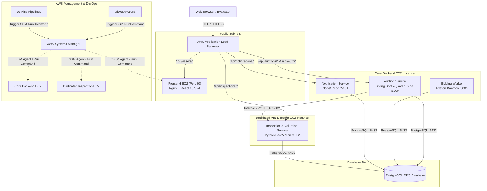

# GearBids | Cloud-Native Microservices Car Auction Platform

---

##  Overview
**GearBids** is an enthusiast car auction platform inspired by **Cars & Bids**. Built for modern cloud infrastructure, it features real-time bidding, signature **anti-sniping countdown mechanics** (extending the auction timer by 2 minutes when late bids arrive), pre-purchase vehicle inspections, VIN decoding, and live outbid push notifications.

---

## System Architecture

---

---

## Microservices Catalog & Documentation

Every component has its own dedicated documentation:

| Microservice / Component | Tech Stack | Port | Target Host | Documentation |
|---|---|---|---|---|
| **Frontend Application** | React 18, TypeScript, Vite, Tailwind CSS | `80` (prod) / `3000` | **Frontend EC2** | [`frontend/README.md`](frontend/README.md) |
| **Auction Core Service** | Java 17, Spring Boot 4, Spring JDBC, HikariCP, Actuator | `5000` | **Core Backend EC2** | [`services/auction-service/README.md`](services/auction-service/README.md) |
| **Bidding Worker Service** | Python 3, `psycopg2`, Daemon loop | `5003` | **Core Backend EC2** | [`services/bidding-worker-service/README.md`](services/bidding-worker-service/README.md) |
| **Notification Service** | Node.js, Express, TypeScript, SSE Stream | `5001` | **Core Backend EC2** | [`services/notification-service/README.md`](services/notification-service/README.md) |
| **Inspection & Valuation Service** | Python 3, FastAPI, Uvicorn | `5002` | **Dedicated VIN Decoder EC2** | [`services/inspection-service/README.md`](services/inspection-service/README.md) |
| **Database Tier** | PostgreSQL 15+ (RDS / EC2) | `5432` | **Amazon RDS PostgreSQL** | [`database/README.md`](database/README.md) |
| **Manual Installation** | Enterprise Linux Deployment Guide | N/A | Test & Prod EC2 | [`docs/MANUAL_ENTERPRISE_INSTALLATION_GUIDE.md`](docs/MANUAL_ENTERPRISE_INSTALLATION_GUIDE.md) |
| **Release & Archiving** | SemVer 2.0.0, S3 Multi-Tier Archiving, Traceability Matrix | N/A | S3 & CI/CD Pipelines | [`docs/RELEASE_AND_VERSION_MANAGEMENT.md`](docs/RELEASE_AND_VERSION_MANAGEMENT.md) |

---

## Authentic Cars & Bids Sample Dataset
The platform comes pre-seeded with authentic enthusiast cars directly modeled after Cars & Bids listings, featuring real VINs, equipment lists, flaws, and photo galleries:

1. **2002 Honda S2000** - AP1, Spa Yellow, 38k miles, 9000 RPM redline.
2. **1997 Toyota Supra Turbo** - Royal Sapphire Pearl, 6-Speed V160, 42k miles, 2JZ-GTE.
3. **2004 Porsche 911 GT3 (996.2)** - Guards Red, Mezger 3.6L, 24k miles *(Ending in 3 min for live anti-sniping testing)*.
4. **1991 BMW M3 (E30)** - Diamond Black, 5-Speed S14 *(Ending in 45 sec for worker lifecycle testing)*.
5. **1994 Mazda RX-7 FD** - Montego Blue Mica, sequential twin-turbo rotary.
6. **2021 Ford Bronco Badlands First Edition** - Cyber Orange, Sasquatch package *(Sold auction)*.
7. **2008 Audi RS4** - Avus Silver, 4.2L V8 8250 RPM *(Reserve not met auction)*.
8. **1999 Nissan Skyline GT-R V-Spec (R34)** - Bayside Blue, RB26DETT AWD.

### Default 1-Click Evaluation Accounts
All accounts share the password: `password123`
- `student_evaluator` (Evaluator profile)
- `doug_demuro` (Admin / Reviewer)
- `track_day_bro` (Active bidder)
- `car_collector_99` (Seller)

---
