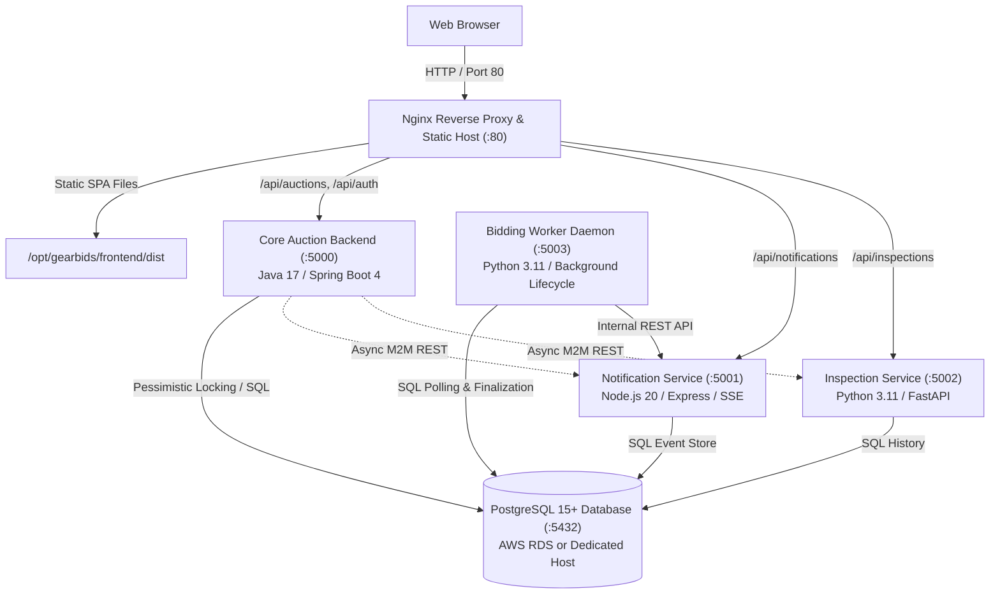

# GearBids Enterprise Platform - Manual Installation & Operations Guide
## Complete Standalone Guide for Building, Installing, and Operating the Full Microservices Suite

---

## 1. Executive Summary & Architecture Overview

The **GearBids** platform is a production-grade automotive enthusiast auction platform. It combines a high-performance Spring Boot 4 core transaction engine, an asynchronous Node.js notification and Server-Sent Events (SSE) daemon, an algorithmic Python vehicle inspection and VIN decoding microservice, an autonomous Python bidding lifecycle worker, an ACID-compliant PostgreSQL database, and a responsive React 18 / TypeScript Single Page Application (SPA) served via Nginx.




### Microservices Suite Architecture Catalog

| Component | Technology Stack | Port | Systemd Service Unit | Responsibility |
| :--- | :--- | :--- | :--- | :--- |
| **Frontend Web App** | React 18, TypeScript, Tailwind CSS, Vite | `80` (HTTP) | `nginx.service` | Enthusiast SPA, real-time bid modal, auction gallery, live countdown timers. |
| **Core Auction Backend** | **Java 17, Spring Boot 4 (`4.0.0-RC2`)**, Spring JDBC, HikariCP | `5000` | `gearbids-auction.service` | Master auction lifecycle, pessimistic locking bids (`SELECT FOR UPDATE`), 120s anti-sniping extension, session cookie auth, rate limiting. |
| **Notification Service** | Node.js 20, TypeScript, Express, `pg` | `5001` | `gearbids-notification.service` | Outbid event distribution, Server-Sent Events (SSE) push streams (`/api/notifications/stream`), unread counters. |
| **Inspection & VIN Decoder** | Python 3.11, FastAPI, Uvicorn, Pydantic | `5002` | `gearbids-inspection.service` | Dedicated NHTSA-compliant 17-character VIN decoding, market valuation engine, 100-point mechanical and cosmetic condition scoring. |
| **Bidding Worker Daemon** | Python 3.11, Background Daemon | `5003` (Metrics) | `gearbids-bidding-worker.service` | Autonomous cron-less finalizer: continuously resolves expired auctions, reserve price logic, and triggers winner events. |
| **Relational Database** | PostgreSQL 15+ | `5432` | Managed RDS or `postgresql.service` | ACID system of record, relational schema, user accounts, and audit log. |

---

## 2. Deployment Topology Models

You can install GearBids in either of two enterprise topologies:

1. **Single-Host Standard Installation (Co-Located)**:
   - All 4 backend microservices, the static frontend build, and Nginx run on a single EC2 instance or virtual machine.
   - The PostgreSQL database runs either locally on the same host or on Amazon RDS PostgreSQL.
   - Recommended for development environments and single-instance test environments.

2. **Multi-Host Enterprise Distributed Topology**:
   - **Backend Host (EC2)**: Runs `gearbids-auction`, `gearbids-notification`, `gearbids-bidding-worker`, and Nginx frontend.
   - **Dedicated VIN Decoder Host (EC2)**: Runs `gearbids-inspection` exclusively on an isolated instance in a private VPC subnet.
   - **Database Cluster**: Amazon RDS PostgreSQL Multi-AZ in private subnets.
   - **Load Balancer**: AWS Application Load Balancer (ALB) routing traffic based on path patterns (`/api/inspections/*` routed to dedicated host target group).

*This guide provides instructions applicable to both topologies. For distributed setups, replace `127.0.0.1` in the configuration files with the target host's private IP.*

---

## 3. System Requirements & Prerequisites

### 3.1 Hardware Recommendations

| Resource | Single-Host (All Services) | Distributed Host (Per Instance) |
| :--- | :--- | :--- |
| **CPU** | 2 to 4 vCPUs (x86_64 or ARM64 Graviton) | 2 vCPUs |
| **RAM** | 4 GB to 8 GB | 2 GB to 4 GB |
| **Storage** | 20 GB to 40 GB SSD | 15 GB SSD |

### 3.2 Operating System Support
- **Amazon Linux 2023 (AL2023)** (Recommended for AWS EC2)
- **Red Hat Enterprise Linux 9 (RHEL 9) / Rocky Linux 9 / AlmaLinux 9**
- **Ubuntu 22.04 LTS / 24.04 LTS**
- **Debian 12**

### 3.3 Installing Prerequisites by Hand

Log into your target host with root or `sudo` privileges.

#### Option A: On Amazon Linux 2023 / RHEL 9

```bash
# Update system packages
sudo dnf update -y

# Install Java 17 (Amazon Corretto or OpenJDK)
sudo dnf install -y java-17-amazon-corretto-devel java-17-amazon-corretto-headless

# Install Node.js 20 LTS & npm
sudo dnf install -y nodejs npm

# Install Python 3.11, pip, and development libraries
sudo dnf install -y python3.11 python3.11-pip python3.11-devel

# Install PostgreSQL 15 client tools, Nginx, Git, Curl, Jq
sudo dnf install -y postgresql15 nginx git jq curl gcc make

# Enable and start Nginx
sudo systemctl enable nginx
```

#### Option B: On Ubuntu 22.04 / 24.04 LTS

```bash
# Update repository catalog
sudo apt-get update -y && sudo apt-get upgrade -y

# Install OpenJDK 17
sudo apt-get install -y openjdk-17-jdk-headless openjdk-17-jre-headless

# Install Node.js 20 LTS via official NodeSource repository
curl -fsSL https://deb.nodesource.com/setup_20.x | sudo -E bash -
sudo apt-get install -y nodejs

# Install Python 3, pip, and venv tooling
sudo apt-get install -y python3 python3-pip python3-venv python3-dev

# Install PostgreSQL 15 client, Nginx, Git, Curl, Jq, build tools
sudo apt-get install -y postgresql-client nginx git jq curl build-essential

# Enable Nginx
sudo systemctl enable nginx
```

### 3.4 Validating Runtimes

Run the following checks to ensure all prerequisite compilers and runtimes are available:

```bash
java -version
# Expected: openjdk version "17.x.x" (or 21+)

node --version
# Expected: v20.x.x (or higher)

npm --version
# Expected: 10.x.x (or higher)

python3 --version
# Expected: Python 3.11.x (or higher)

psql --version
# Expected: psql (PostgreSQL) 15.x (or 16.x)

nginx -v
# Expected: nginx version: nginx/1.x
```

---

## 4. System User, Groups & Filesystem Hierarchy

In accordance with enterprise security benchmarks (CIS Level 1 & SEC-16), microservice processes must **never** run as `root`. We establish a dedicated non-login system account and a locked-down directory tree.

```bash
# 1. Create restricted system group and user
sudo groupadd -r gearbids
sudo useradd -r -g gearbids -s /sbin/nologin -d /opt/gearbids -c "GearBids Service Account" gearbids

# 2. Establish directory hierarchy
sudo mkdir -p /opt/gearbids/frontend/dist
sudo mkdir -p /opt/gearbids/services/auction-service
sudo mkdir -p /opt/gearbids/services/notification-service
sudo mkdir -p /opt/gearbids/services/inspection-service
sudo mkdir -p /opt/gearbids/services/bidding-worker-service
sudo mkdir -p /opt/gearbids/database
sudo mkdir -p /etc/gearbids
sudo mkdir -p /var/log/gearbids

# 3. Apply secure ownership and permissions
sudo chown -R gearbids:gearbids /opt/gearbids /etc/gearbids /var/log/gearbids
sudo chmod 750 /opt/gearbids
sudo chmod 700 /etc/gearbids
sudo chmod 755 /var/log/gearbids
```

---

## 5. PostgreSQL Database Provisioning & Schema Initialization

The platform requires a PostgreSQL 15+ database instance (either self-hosted PostgreSQL or AWS RDS PostgreSQL).

### 5.1 Step 1: Connect to PostgreSQL and Create Database

Export your master database connection credentials:

```bash
export DB_HOST="your-db-host.rds.amazonaws.com"  # or "localhost" if running locally
export DB_PORT="5432"
export MASTER_USER="postgres"
export PGPASSWORD="YourMasterPasswordHere"
```

Verify connectivity:
```bash
psql -h "${DB_HOST}" -p "${DB_PORT}" -U "${MASTER_USER}" -d postgres -c "SELECT version();"
```

Create the application database and application user :
```sql
psql -h "${DB_HOST}" -p "${DB_PORT}" -U "${MASTER_USER}" -d postgres << 'SQL_EOF'
-- Create application database if it does not already exist
SELECT 'CREATE DATABASE gearbids'
WHERE NOT EXISTS (SELECT FROM pg_database WHERE datname = 'gearbids')\gexec

-- Create dedicated application user if it does not already exist
DO $$
BEGIN
  IF NOT EXISTS (SELECT FROM pg_roles WHERE rolname = 'gearbids_user') THEN
    CREATE ROLE gearbids_user WITH LOGIN PASSWORD 'GearBidsSecurePass2026!';
  END IF;
END
$$;

-- Grant privileges
GRANT ALL PRIVILEGES ON DATABASE gearbids TO gearbids_user;
SQL_EOF
```

### 5.2 Step 2: Apply DDL Schema

Clone the project repository to your build or management machine:

```bash
git clone <repo-name>
cd gearbids
git checkout main
```

Execute the database schema file `database/schema.sql` directly using `psql`:

```bash
export PGPASSWORD="GearBidsSecurePass2026!"
psql -h "${DB_HOST}" -p "${DB_PORT}" -U "gearbids_user" -d "gearbids" -f database/schema.sql
```

### 5.3 Step 3: Apply Authentic Seed Data

Populate the database with Cars & Bids sample listings, specs, inspections, and verified user accounts:

```bash
psql -h "${DB_HOST}" -p "${DB_PORT}" -U "gearbids_user" -d "gearbids" -f database/seed.sql
```

### 5.4 Step 4: Verify Database Tables and Seed Records

Verify that all tables and seed records are present:

```bash
psql -h "${DB_HOST}" -p "${DB_PORT}" -U "gearbids_user" -d "gearbids" -c "
SELECT table_name, 
       (xpath('/row/cnt/text()', xml_count))[1]::text::int as row_count
FROM (
  SELECT table_name, 
         query_to_xml(format('select count(*) as cnt from %I', table_name), false, true, '') as xml_count
  FROM information_schema.tables
  WHERE table_schema = 'public' AND table_type = 'BASE TABLE'
) t ORDER BY table_name;
"
```

Expected output includes:
- `auctions`: 8 active / historical enthusiast listings
- `bids`: Initial realistic bid histories
- `comments`: Community discussion threads
- `inspections`: Valuation and condition scoring reports
- `users`: 5 seeded demo and evaluator accounts
- `vehicles`: Factory specifications, VINs, options, and flaws

#### Seeded Demo & Evaluator Accounts Reference

All seeded accounts are protected by standard 10-round BCrypt cryptographic hashes matching the password **`password123`**:

| Username | Email | Role | Bio / Description |
| :--- | :--- | :--- | :--- |
| **`student_evaluator`** | `evaluator@pxl.be` | Admin / Seller | Course Evaluator test account for DevOps and microservice validation. |
| **`doug_demuro`** | `doug@gearbids.com` | Admin / Founder | Founder & enthusiast. *"THIS... is GearBids!"* |
| **`car_collector_99`** | `collector@example.com` | Seller | Marcus Vance: JDM and European sports car curator. |
| **`track_day_bro`** | `trackday@example.com` | Bidder | Elena Rostova: Club racer, HPDE instructor. |
| **`turbo_enthusiast`** | `turbo@example.com` | Bidder | David Chen: Twin-turbo homologation specials collector. |

---

## 6. Building All Services from Source Code

From your cloned repository directory (`gearbids`), execute the build commands for each component.

### 6.1 Build Core Auction Backend (Java 17 / Spring Boot 4)

The Core Auction backend is an enterprise Java microservice built using Apache Maven.

```bash
cd services/auction-service

# Ensure maven wrapper executable bit is set
chmod +x ./mvnw

# Execute unit and mock tests and package the executable fat JAR
./mvnw clean package -DskipTests=false -B

# Verify the compiled binary
ls -lh target/gearbids-auction-service.jar
```

*Expected output*: `target/gearbids-auction-service.jar` (~24 MB executable fat JAR containing Spring Boot 4, HikariCP, and embedded Tomcat).

### 6.2 Build Frontend Single Page Application (React 18 / Vite / TypeScript)

```bash
cd ../../frontend

# Install node dependencies
npm ci || npm install

# Build the production bundle
npm run build

# Verify build output
ls -lh dist/index.html dist/assets/
```

*Expected output*: `dist/index.html` and bundled CSS/JS in `dist/assets/`.

### 6.3 Build Notification Service (Node.js 20 / TypeScript / Express)

```bash
cd ../services/notification-service

# Install all build dependencies
npm ci || npm install

# Compile TypeScript into JavaScript
npm run build

# Verify build output
ls -lh dist/server.js dist/app.js
```

*Expected output*: `dist/server.js` and `dist/app.js` generated from TypeScript sources.

### 6.4 Build Python Virtual Environment for Inspection & Worker Services

We create a unified, hardened Python virtual environment located at `/opt/gearbids/venv`:

```bash
cd ../..

# 1. Create isolated virtual environment
sudo python3 -m venv /opt/gearbids/venv

# 2. Upgrade pip inside the virtual environment
sudo /opt/gearbids/venv/bin/pip install --upgrade pip

# 3. Install Inspection Service dependencies (FastAPI, Uvicorn, Pydantic, psycopg2)
sudo /opt/gearbids/venv/bin/pip install -r services/inspection-service/requirements.txt

# 4. Install Bidding Worker Service dependencies (requests, psycopg2)
sudo /opt/gearbids/venv/bin/pip install -r services/bidding-worker-service/requirements.txt

# 5. Lock permissions to gearbids service user
sudo chown -R gearbids:gearbids /opt/gearbids/venv
```

---

## 7. Artifact Deployment & Filesystem Installation

Now copy all built binaries, static assets, and source files into the production filesystem `/opt/gearbids`:

### 7.1 Deploy Frontend Static Assets
```bash
sudo cp -r frontend/dist/* /opt/gearbids/frontend/dist/
sudo chown -R gearbids:gearbids /opt/gearbids/frontend
sudo chmod -R 755 /opt/gearbids/frontend/dist
```

### 7.2 Deploy Core Auction Service
```bash
sudo cp services/auction-service/target/gearbids-auction-service.jar /opt/gearbids/services/auction-service/
sudo chown -R gearbids:gearbids /opt/gearbids/services/auction-service
sudo chmod 750 /opt/gearbids/services/auction-service/gearbids-auction-service.jar
```

### 7.3 Deploy Notification Service
```bash
sudo cp -r services/notification-service/dist /opt/gearbids/services/notification-service/
sudo cp services/notification-service/package.json /opt/gearbids/services/notification-service/
sudo cp services/notification-service/package-lock.json /opt/gearbids/services/notification-service/

# Install production-only dependencies in deployment directory
cd /opt/gearbids/services/notification-service
sudo npm ci --omit=dev || sudo npm install --omit=dev
sudo chown -R gearbids:gearbids /opt/gearbids/services/notification-service
cd -
```

### 7.4 Deploy Vehicle Inspection Service
```bash
sudo cp services/inspection-service/main.py /opt/gearbids/services/inspection-service/
sudo cp services/inspection-service/valuation_engine.py /opt/gearbids/services/inspection-service/
sudo chown -R gearbids:gearbids /opt/gearbids/services/inspection-service
sudo chmod 750 /opt/gearbids/services/inspection-service/*.py
```

### 7.5 Deploy Bidding Worker Service
```bash
sudo cp services/bidding-worker-service/worker.py /opt/gearbids/services/bidding-worker-service/
sudo chown -R gearbids:gearbids /opt/gearbids/services/bidding-worker-service
sudo chmod 750 /opt/gearbids/services/bidding-worker-service/*.py
```

---

## 8. Configuration Management & Environment Files

Every service reads its runtime credentials and networking topology from an environment file located in `/etc/gearbids/`. We write each file by hand.

### 8.1 Core Auction Service Configuration (`/etc/gearbids/auction-service.env`)

```bash
sudo tee /etc/gearbids/auction-service.env << 'ENV_EOF'
PORT=5000
APP_VERSION=1.0.0
RELEASE_TAG=v1.0.0
GIT_COMMIT=b9715a59435602cbf86b2e39652a1e5a2162cbaa

# Database Connection (RDS or Dedicated Host)
DB_HOST=your-db-host.rds.amazonaws.com
DB_PORT=5432
DB_USER=gearbids_user
DB_PASSWORD=GearBidsSecurePass2026!
DB_NAME=gearbids
DB_SSL_MODE=prefer

# Machine-to-Machine Internal Service URLs
NOTIFICATIONS_SERVICE_URL=http://127.0.0.1:5001
INSPECTIONS_SERVICE_URL=http://127.0.0.1:5002
INTERNAL_SERVICE_TOKEN=gearbids-internal-service-token-dev

# Security & CORS Origins
ALLOWED_ORIGINS=http://localhost:3000,http://localhost:80,http://127.0.0.1:3000,http://localhost
COOKIE_SECURE=false
COOKIE_MAX_AGE=86400s
ENV_EOF
```

### 8.2 Notification Service Configuration (`/etc/gearbids/notification-service.env`)

```bash
sudo tee /etc/gearbids/notification-service.env << 'ENV_EOF'
PORT=5001
NODE_ENV=production
APP_VERSION=1.0.0
RELEASE_TAG=v1.0.0
GIT_COMMIT=b9715a59435602cbf86b2e39652a1e5a2162cbaa

# Database Connection
DB_HOST=your-db-host.rds.amazonaws.com
DB_PORT=5432
DB_USER=gearbids_user
DB_PASSWORD=GearBidsSecurePass2026!
DB_NAME=gearbids
DB_SSL=false

INTERNAL_SERVICE_TOKEN=gearbids-internal-service-token-dev
ALLOWED_ORIGINS=http://localhost:3000,http://localhost:80,http://127.0.0.1:3000,http://localhost
ENV_EOF
```

### 8.3 Vehicle Inspection Service Configuration (`/etc/gearbids/inspection-service.env`)

```bash
sudo tee /etc/gearbids/inspection-service.env << 'ENV_EOF'
PORT=5002
PYTHONUNBUFFERED=1
APP_VERSION=1.0.0
RELEASE_TAG=v1.0.0
GIT_COMMIT=b9715a59435602cbf86b2e39652a1e5a2162cbaa

# Database Connection
DB_HOST=your-db-host.rds.amazonaws.com
DB_PORT=5432
DB_USER=gearbids_user
DB_PASSWORD=GearBidsSecurePass2026!
DB_NAME=gearbids

INTERNAL_SERVICE_TOKEN=gearbids-internal-service-token-dev
ALLOWED_ORIGINS=http://localhost:3000,http://localhost:80,http://127.0.0.1:3000,http://localhost
ENV_EOF
```

### 8.4 Bidding Worker Service Configuration (`/etc/gearbids/bidding-worker.env`)

```bash
sudo tee /etc/gearbids/bidding-worker.env << 'ENV_EOF'
WORKER_PORT=5003
CHECK_INTERVAL_SECONDS=2
PYTHONUNBUFFERED=1
APP_VERSION=1.0.0
RELEASE_TAG=v1.0.0
GIT_COMMIT=b9715a59435602cbf86b2e39652a1e5a2162cbaa

# Database Connection
DB_HOST=your-db-host.rds.amazonaws.com
DB_PORT=5432
DB_USER=gearbids_user
DB_PASSWORD=GearBidsSecurePass2026!
DB_NAME=gearbids

# Upstream Notification Endpoint
NOTIFICATIONS_SERVICE_URL=http://127.0.0.1:5001
INTERNAL_SERVICE_TOKEN=gearbids-internal-service-token-dev
ENV_EOF
```

### 8.5 Lock Down Permissions on Secrets

```bash
sudo chown -R gearbids:gearbids /etc/gearbids
sudo chmod 600 /etc/gearbids/*.env
```

---

## 9. Systemd Service Units Installation & Daemon Management

Deploy systemd unit definitions to control process lifecycles, automated restart on failure, sandbox security, and journal logging.

### 9.1 Unit 1: Core Auction Service (`/etc/systemd/system/gearbids-auction.service`)

```bash
sudo tee /etc/systemd/system/gearbids-auction.service << 'UNIT_EOF'
[Unit]
Description=GearBids Auction Core Microservice (Spring Boot 4)
After=network.target postgresql.service
Wants=network-online.target

[Service]
Type=simple
User=gearbids
Group=gearbids
WorkingDirectory=/opt/gearbids/services/auction-service
EnvironmentFile=-/etc/gearbids/auction-service.env
Environment=PORT=5000
ExecStart=/usr/bin/java -jar /opt/gearbids/services/auction-service/gearbids-auction-service.jar
Restart=always
RestartSec=5s
StandardOutput=journal
StandardError=journal
SyslogIdentifier=gearbids-auction

# Security sandbox
ProtectSystem=full
NoNewPrivileges=true
PrivateTmp=true

[Install]
WantedBy=multi-user.target
UNIT_EOF
```

### 9.2 Unit 2: Notification Service (`/etc/systemd/system/gearbids-notification.service`)

```bash
sudo tee /etc/systemd/system/gearbids-notification.service << 'UNIT_EOF'
[Unit]
Description=GearBids Outbid and Event Notification Microservice
After=network.target postgresql.service
Wants=network-online.target

[Service]
Type=simple
User=gearbids
Group=gearbids
WorkingDirectory=/opt/gearbids/services/notification-service
EnvironmentFile=-/etc/gearbids/notification-service.env
Environment=NODE_ENV=production
Environment=PORT=5001
ExecStart=/usr/bin/node dist/server.js
Restart=always
RestartSec=5s
StandardOutput=journal
StandardError=journal
SyslogIdentifier=gearbids-notification

# Security sandbox
ProtectSystem=full
NoNewPrivileges=true
PrivateTmp=true

[Install]
WantedBy=multi-user.target
UNIT_EOF
```

### 9.3 Unit 3: Inspection Service (`/etc/systemd/system/gearbids-inspection.service`)

```bash
sudo tee /etc/systemd/system/gearbids-inspection.service << 'UNIT_EOF'
[Unit]
Description=GearBids Vehicle Inspection and Valuation Microservice
After=network.target postgresql.service
Wants=network-online.target

[Service]
Type=simple
User=gearbids
Group=gearbids
WorkingDirectory=/opt/gearbids/services/inspection-service
EnvironmentFile=-/etc/gearbids/inspection-service.env
Environment=PYTHONUNBUFFERED=1
Environment=PORT=5002
ExecStart=/opt/gearbids/venv/bin/python3 -m uvicorn main:app --host 0.0.0.0 --port 5002
Restart=always
RestartSec=5s
StandardOutput=journal
StandardError=journal
SyslogIdentifier=gearbids-inspection

# Security sandbox
ProtectSystem=full
NoNewPrivileges=true
PrivateTmp=true

[Install]
WantedBy=multi-user.target
UNIT_EOF
```

### 9.4 Unit 4: Bidding Worker Daemon (`/etc/systemd/system/gearbids-bidding-worker.service`)

```bash
sudo tee /etc/systemd/system/gearbids-bidding-worker.service << 'UNIT_EOF'
[Unit]
Description=GearBids Bidding and Auction Lifecycle Worker Service
After=network.target postgresql.service
Wants=network-online.target

[Service]
Type=simple
User=gearbids
Group=gearbids
WorkingDirectory=/opt/gearbids/services/bidding-worker-service
EnvironmentFile=-/etc/gearbids/bidding-worker.env
Environment=PYTHONUNBUFFERED=1
Environment=WORKER_PORT=5003
ExecStart=/opt/gearbids/venv/bin/python3 worker.py
Restart=always
RestartSec=5s
StandardOutput=journal
StandardError=journal
SyslogIdentifier=gearbids-worker

# Security sandbox
ProtectSystem=full
NoNewPrivileges=true
PrivateTmp=true

[Install]
WantedBy=multi-user.target
UNIT_EOF
```

### 9.5 Reload and Start All Microservices

```bash
# Reload systemd manager configuration
sudo systemctl daemon-reload

# Enable all units to launch automatically at system boot
sudo systemctl enable gearbids-auction gearbids-notification gearbids-inspection gearbids-bidding-worker

# Start all units immediately
sudo systemctl start gearbids-auction gearbids-notification gearbids-inspection gearbids-bidding-worker

# Verify active status
sudo systemctl status gearbids-auction gearbids-notification gearbids-inspection gearbids-bidding-worker --no-pager
```

*Every service should report `Active: active (running)`.*

---

## 10. Nginx Web Server & Reverse Proxy Configuration

Nginx acts as the high-speed HTTP gateway, serving the compiled React Single Page Application (SPA), routing REST API and Server-Sent Event (SSE) requests to the appropriate upstream ports, and terminating static assets with caching headers.

### 10.1 Install Nginx Configuration File

#### On Amazon Linux 2023 / RHEL 9:
Write `/etc/nginx/conf.d/gearbids.conf`:

```bash
sudo tee /etc/nginx/conf.d/gearbids.conf << 'NGINX_EOF'
server {
    listen 80 default_server;
    listen [::]:80 default_server;
    server_name _;

    root /opt/gearbids/frontend/dist;
    index index.html;

    # Security Headers (SEC-11)
    add_header X-Frame-Options "DENY" always;
    add_header X-Content-Type-Options "nosniff" always;
    add_header Referrer-Policy "strict-origin-when-cross-origin" always;
    add_header Permissions-Policy "camera=(), microphone=(), geolocation=()" always;
    add_header Content-Security-Policy "default-src 'self'; script-src 'self' 'unsafe-inline'; style-src 'self' 'unsafe-inline' https://fonts.googleapis.com; font-src 'self' https://fonts.gstatic.com data:; img-src 'self' data: https:; connect-src 'self' ws: wss: http: https:;" always;

    # Gzip Compression
    gzip on;
    gzip_vary on;
    gzip_min_length 1024;
    gzip_proxied expired no-cache no-store private auth;
    gzip_types text/plain text/css text/xml text/javascript application/x-javascript application/xml application/javascript application/json;

    # Load Balancer Health Probe
    location /health {
        access_log off;
        return 200 "healthy\n";
        add_header Content-Type text/plain;
    }

    # Static Assets Caching
    location /assets/ {
        expires 1y;
        add_header Cache-Control "public, no-transform, immutable";
    }

    # Core Auction Backend API
    location /api/auctions {
        proxy_pass http://127.0.0.1:5000;
        proxy_http_version 1.1;
        proxy_set_header Host $host;
        proxy_set_header X-Real-IP $remote_addr;
        proxy_set_header X-Forwarded-For $proxy_add_x_forwarded_for;
        proxy_set_header X-Forwarded-Proto $scheme;
    }

    # Session Authentication API
    location /api/auth {
        proxy_pass http://127.0.0.1:5000;
        proxy_http_version 1.1;
        proxy_set_header Host $host;
        proxy_set_header X-Real-IP $remote_addr;
        proxy_set_header X-Forwarded-For $proxy_add_x_forwarded_for;
        proxy_set_header X-Forwarded-Proto $scheme;
    }

    # Server-Sent Events (SSE) & Notification API
    location /api/notifications {
        proxy_pass http://127.0.0.1:5001;
        proxy_http_version 1.1;
        proxy_set_header Connection '';
        proxy_set_header Host $host;
        proxy_buffering off;
        proxy_cache off;
        chunked_transfer_encoding off;
        proxy_read_timeout 24h;
    }

    # Vehicle Inspection & VIN Decoder API
    location /api/inspections {
        proxy_pass http://127.0.0.1:5002;
        proxy_http_version 1.1;
        proxy_set_header Host $host;
        proxy_set_header X-Real-IP $remote_addr;
        proxy_set_header X-Forwarded-For $proxy_add_x_forwarded_for;
        proxy_set_header X-Forwarded-Proto $scheme;
    }

    # Single Page Application Routing Fallback
    location / {
        try_files $uri $uri/ /index.html;
    }
}
NGINX_EOF
```

#### On Ubuntu / Debian:
Save the same configuration block to `/etc/nginx/sites-available/gearbids` and activate it:
```bash
sudo tee /etc/nginx/sites-available/gearbids < /etc/nginx/conf.d/gearbids.conf 2>/dev/null || true
sudo ln -sf /etc/nginx/sites-available/gearbids /etc/nginx/sites-enabled/gearbids
sudo rm -f /etc/nginx/sites-enabled/default
```

### 10.2 Test and Reload Nginx

```bash
# Validate Nginx syntax
sudo nginx -t

# Reload configuration
sudo systemctl reload nginx || sudo systemctl restart nginx
```

---

## 11. Comprehensive Platform Verification & End-to-End Testing

Verify every component systematically using standard `curl` commands.

### 11.1 Health Probes Across All Microservices

#### 1. Nginx Gateway & Static Web Tier (Port 80)
```bash
curl -i http://localhost/health
```
*Expected*: HTTP 200 with body `healthy`.

#### 2. Core Auction Microservice (Port 5000)
```bash
curl -s http://localhost:5000/health | jq .
curl -s http://localhost:5000/api/version | jq .
curl -s http://localhost:5000/actuator/health | jq .
```
*Expected*:
```json
{
  "status": "healthy",
  "service": "gearbids-auction-service",
  "version": "1.0.0",
  "release_tag": "v1.0.0"
}
```

#### 3. Notification Microservice (Port 5001)
```bash
curl -s http://localhost:5001/health | jq .
```
*Expected*: `{"status":"healthy","service":"gearbids-notification-service","version":"1.0.0"}`.

#### 4. Vehicle Inspection Microservice (Port 5002)
```bash
curl -s http://localhost:5002/health | jq .
```
*Expected*: `{"status":"healthy","service":"gearbids-inspection-service","version":"1.0.0"}`.

#### 5. Bidding Worker Daemon (Port 5003)
```bash
curl -s http://localhost:5003/health | jq .
curl -s http://localhost:5003/metrics | jq .
```
*Expected*: `{"status":"running","db_connected":true,"auctions_closed_total":...}`.

---

### 11.2 Testing Dedicated VIN Decoding by Hand

Test the analytical VIN decoding engine with a realistic enthusiast VIN:

```bash
curl -s http://localhost:5002/api/inspections/decode/JHMAP11422T001842 | jq .
```

*Expected output*:
```json
{
  "vin": "JHMAP11422T001842",
  "valid_format": true,
  "country_of_origin": "Japan",
  "manufacturer": "Honda Motor Co., Ltd.",
  "model_year": 2002,
  "vehicle_type": "Passenger Car"
}
```

---

### 11.3 Testing User Authentication & Session Fixation Defenses by Hand

Log in as the seeded course evaluation user (`student_evaluator` with password `password123`):

```bash
# 1. Execute login and store session cookie in 'cookies.txt'
curl -i -X POST http://localhost/api/auth/login \
  -H "Content-Type: application/json" \
  -c cookies.txt \
  -d '{"usernameOrEmail":"student_evaluator","password":"password123"}'
```

*Expected response*:
```
HTTP/1.1 200 OK
Set-Cookie: gearbids.sid=...; Path=/; HttpOnly; SameSite=Lax
Content-Type: application/json

{"message":"Login successful","user":{"id":5,"username":"student_evaluator","email":"evaluator@pxl.be","is_admin":true,"is_seller":true}}
```

Now verify the authenticated session using the saved cookie:
```bash
curl -s http://localhost/api/auth/me -b cookies.txt | jq .
```

*Expected output*:
```json
{
  "authenticated": true,
  "user": {
    "id": 5,
    "username": "student_evaluator",
    "email": "evaluator@pxl.be",
    "full_name": "Cloud Evaluation Account",
    "is_seller": true,
    "is_admin": true
  }
}
```

---

### 11.4 Testing Auction Queries, Bidding & Anti-Sniping

#### 1. Fetch Active Auction Catalog
```bash
curl -s http://localhost/api/auctions | jq '.auctions[] | {id, title, current_bid, status}'
```

#### 2. Query Platform Statistics
```bash
curl -s http://localhost/api/auctions/stats | jq .
```

#### 3. Place a Competitive Bid (Enforcing Pessimistic Locking & Validation)
Place a valid increment bid on auction ID 1 using the authenticated cookie:

```bash
curl -i -X POST http://localhost/api/auctions/1/bid \
  -H "Content-Type: application/json" \
  -b cookies.txt \
  -d '{"amount": 35000.00}'
```

*Expected response*: HTTP 200 with updated `current_bid`, new `high_bidder_id`, and `anti_sniping_extended: false` (or `true` if placed in the final 120 seconds).

---

### 11.5 Testing Server-Sent Events (SSE) Live Feed

Verify that the notification streaming endpoint connects cleanly:

```bash
curl -N -H "Accept: text/event-stream" "http://localhost/api/notifications/stream?userId=5"
```

*Expected response*: Immediate HTTP 200 stream header followed by the keepalive ping event:
```
event: message
data: {"type":"CONNECTED","message":"Notification stream connected"}
```
*(Press `Ctrl+C` to close the stream).*

---

## 12. Operational Runbooks, Maintenance & Disaster Recovery

### 12.1 Real-Time Systemd Log Streaming

Monitor real-time operational logs across all units:

```bash
# Monitor Core Auction Spring Boot logs
sudo journalctl -u gearbids-auction -f -o cat

# Monitor Notification Node.js logs
sudo journalctl -u gearbids-notification -f -o cat

# Monitor Inspection FastAPI logs
sudo journalctl -u gearbids-inspection -f -o cat

# Monitor Bidding Worker logs
sudo journalctl -u gearbids-bidding-worker -f -o cat

# Monitor Nginx access and error logs
sudo tail -f /var/log/nginx/access.log /var/log/nginx/error.log
```

---

### 12.2 Zero-Downtime Rolling Binary Update

When deploying an updated Spring Boot fat JAR (`gearbids-auction-service.jar`):

```bash
# 1. Copy new binary to temporary file
sudo cp /tmp/gearbids-auction-service-new.jar /opt/gearbids/services/auction-service/gearbids-auction-service.jar.new

# 2. Atomic swap
sudo mv /opt/gearbids/services/auction-service/gearbids-auction-service.jar.new /opt/gearbids/services/auction-service/gearbids-auction-service.jar
sudo chown gearbids:gearbids /opt/gearbids/services/auction-service/gearbids-auction-service.jar
sudo chmod 750 /opt/gearbids/services/auction-service/gearbids-auction-service.jar

# 3. Restart daemon
sudo systemctl restart gearbids-auction

# 4. Verify healthy return
curl -f http://localhost:5000/health
```

---

### 12.3 Database Backup & Restoration

#### Create a Full Relational Database Backup:
```bash
export PGPASSWORD="GearBidsSecurePass2026!"
pg_dump -h "${DB_HOST}" -p "${DB_PORT}" -U "gearbids_user" -d "gearbids" -F c -b -v -f "/var/log/gearbids/backup_$(date +%Y%m%d_%H%M%S).dump"
```

#### Restore from Backup:
```bash
pg_restore -h "${DB_HOST}" -p "${DB_PORT}" -U "gearbids_user" -d "gearbids" -v --clean "/var/log/gearbids/backup_YYYYMMDD_HHMMSS.dump"
```

---

### 12.4 Troubleshooting Common Scenarios

| Issue Symptom | Root Cause | Resolution |
| :--- | :--- | :--- |
| **`401 Unauthorized` on Login** | Database not seeded with valid BCrypt hashes. | Execute `psql -h $DB_HOST -U gearbids_user -d gearbids -f database/seed.sql` to reload valid hashes for `password123`. |
| **`502 Bad Gateway` on `/api/auctions`** | Spring Boot `gearbids-auction` service is stopped or still booting. | Inspect `sudo journalctl -u gearbids-auction -n 50 --no-pager`. Verify PostgreSQL connectivity from host. |
| **`502 Bad Gateway` on `/api/notifications/stream`** | Nginx proxy buffering is enabled, choking SSE HTTP chunked stream. | Ensure `proxy_buffering off; chunked_transfer_encoding off;` is configured in `/etc/nginx/conf.d/gearbids.conf`. |
| **Session cookie lost on next page load** | `COOKIE_SECURE=true` while browsing over plain HTTP without TLS. | In `/etc/gearbids/auction-service.env`, set `COOKIE_SECURE=false` when serving over HTTP, then `sudo systemctl restart gearbids-auction`. |
| **`Inspection Service Connection Refused`** | Dedicated inspection host Security Group blocking port `5002` or `INSPECTIONS_SERVICE_URL` misconfigured. | In `/etc/gearbids/auction-service.env`, verify `INSPECTIONS_SERVICE_URL=http://<IP>:5002`. Verify `gearbids-inspection` is listening with `sudo ss -tulpn \| grep 5002`. |

## 13. Local Development & Rapid Verification via Docker Compose (Non-Production Only)

For rapid local developer iteration, local smoke testing, or offline functional grading, the repository provides a root [`docker-compose.yml`](../docker-compose.yml) definition that spins up the complete multi-service stack in isolated local containers.

> [!IMPORTANT]
> **Enterprise Production & Evaluation Constraint Notice**:
> Docker Compose is provided strictly for **convenient local development and offline verification**.
### 13.1 Local Container Topology & Port Allocation

When launched via `docker-compose.yml`, the following 6 containers are instantiated on a shared internal bridge network:

| Container Name | Service | Exposed Host Port | Container Port | Purpose in Local Development |
| :--- | :--- | :--- | :--- | :--- |
| `gearbids-frontend` | Frontend SPA | `3000` | `80` (Nginx) | React 18 / Vite single page app with reverse proxy to backend containers. |
| `gearbids-auction-service` | Core Auction | `5000` | `5000` | Spring Boot 4 Java backend with HikariCP connection pool to `postgres`. |
| `gearbids-notification-service`| Notifications| `5001` | `5001` | Node.js / Express Server-Sent Events (SSE) notification service. |
| `gearbids-inspection-service` | VIN Decoder | `5002` | `5002` | Python 3.11 / FastAPI algorithmic VIN and condition valuation service. |
| `gearbids-bidding-worker` | Bidding Worker | `5003` | `5003` (Metrics)| Background lifecycle daemon monitoring active auctions every 2 seconds. |
| `gearbids-postgres` | Relational DB | `5432` | `5432` | PostgreSQL 15 Alpine with `pgdata` volume and automated schema/seed initialization. |

---

### 13.2 Starting the Local Development Stack

Run the following command from the root of the cloned repository to build container images and start all services in the background:

```bash
# Build container images and start all 6 services in detached mode
docker compose up --build -d
```

Verify that all 6 containers are running and healthy:

```bash
docker compose ps
```

*Expected output*: All containers report `STATUS: Up` with `gearbids-postgres` and `gearbids-auction-service` showing `(healthy)`.

---

### 13.3 Accessing the Local Platform

- **Web Application UI**: Open `http://localhost:3000` in your web browser.
- **Auction Core REST API**: `http://localhost:5000`
- **Notification SSE Endpoint**: `http://localhost:5001/api/notifications/stream?userId=5`
- **VIN Inspection Engine**: `http://localhost:5002/api/inspections/decode/JHMAP11422T001842`

#### One-Click Quick Logins for Local Testing
In the web UI modal, you can use one-click evaluator logins or manually log in using the shared password **`password123`**:
- `student_evaluator` / `password123` (Administrator)
- `doug_demuro` / `password123` (Platform Founder)
- `car_collector_99` / `password123` (VIP Seller)
- `track_day_bro` / `password123` (Enthusiast Bidder)

---

### 13.4 Rapid Local Verification Commands

You can execute quick automated checks directly against the local Docker containers:

#### 1. Microservice Health Probes
```bash
# Frontend Nginx Gateway
curl -i http://localhost:3000/health

# Spring Boot Auction Service
curl -s http://localhost:5000/health | jq .

# Notification Microservice
curl -s http://localhost:5001/health | jq .

# VIN Decoder Microservice
curl -s http://localhost:5002/health | jq .

# Bidding Worker Metrics
curl -s http://localhost:5003/metrics | jq .
```

#### 2. Local Authentication & Session Cookie Smoke Test
```bash
# Log in via local Nginx reverse proxy
curl -i -X POST http://localhost:3000/api/auth/login \
  -H "Content-Type: application/json" \
  -c /tmp/docker-cookies.txt \
  -d '{"usernameOrEmail":"student_evaluator","password":"password123"}'

# Verify session state with saved cookie
curl -s http://localhost:3000/api/auth/me -b /tmp/docker-cookies.txt | jq .
```

#### 3. Run Automated 7-Step Integration Test Suite Locally
Execute the end-to-end integration test against the local Docker stack:

```bash
python3 tests/e2e/e2e_flow_test.py --base-url http://localhost:5000
```

---

### 13.5 Container Log Monitoring

Stream logs for a specific service or for the entire stack:

```bash
# Stream all container logs
docker compose logs -f

# Stream only the Spring Boot Core Auction service
docker compose logs -f auction-service

# Stream only the Bidding Lifecycle Worker
docker compose logs -f bidding-worker-service
```

---

### 13.6 Stopping and Resetting the Local Environment

#### Standard Stop (Preserving Database Volume)
```bash
docker compose down
```

#### Complete Clean Reset (Wiping Database Volume & Refreshing Seeds)
When modifying `database/schema.sql` or `database/seed.sql`, PostgreSQL only executes scripts in `/docker-entrypoint-initdb.d/` if the database data directory is completely empty. To reset the database to a clean initial state:

```bash
# Stop containers and remove persistent database volumes (-v flag)
docker compose down -v

# Re-launch with clean database and re-executed seed data
docker compose up --build -d
```
